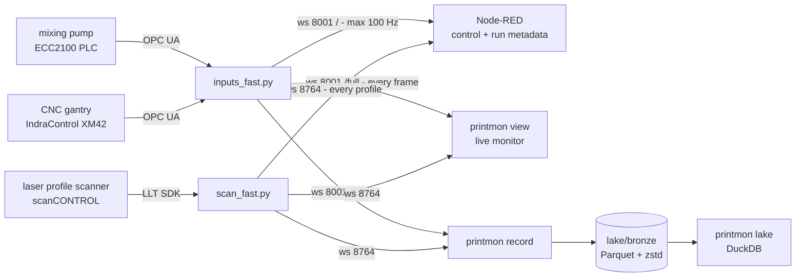

# printmon - acquisition, monitoring and storage for the BAM 3D concrete printer



Node-RED also sends `start_scan` / `stop_scan` on port 8764; only that client's
disconnect stops the scan, so the viewer and recorder can come and go freely.

Every consumer receives every frame independently; none can slow acquisition or another
consumer. Node-RED keeps all process control - the viewer and recorder only listen.

## Setup

```powershell
py -3.11 -m venv venv
venv\Scripts\pip install -e ".[viewer,acquisition,dev]"
copy .env.example .env      # then edit: equipment addresses and node ids for this installation
```

`.env` holds the OPC UA endpoints and node ids and is gitignored; `.env.example` documents every key.
Without it the acquisition services print a clear warning and keep retrying - everything
else (simulation, replay, recorder, viewer, tests) runs without any equipment configured.

## In the lab

Run each in its own terminal, from this folder:

```powershell
venv\Scripts\python inputs_fast.py          # replaces inputs.py
venv\Scripts\python scan_fast.py            # replaces scan.py
venv\Scripts\python -m printmon view        # live monitor
venv\Scripts\python -m printmon record --label "what this run is"
```

Start Node-RED as usual, and start the scan from its dashboard as usual. After a run,
check what was captured - rates, dropped profiles, storage latency:

```powershell
venv\Scripts\python -m printmon lake --origin live
```

**Fallback:** `inputs.py`, `outputs.py` and `scan.py` still work. If anything misbehaves,
stop the `_fast` services and start the originals; Node-RED works with either. (Their only
change is reading endpoints and node ids from `.env` instead of hardcoded values.)

## The viewer

- **Monitor** - laser profile with the C (rotary) axis annotated; bead width against the
  target; one plot per sensor chosen from **Sensors**, each with a gauge showing the current
  value and that signal's sample rate. **Engineering units** converts raw counts using the
  calibration notebook (`printmon/units.py`); storage always keeps raw values.
- **Bead & layers** - GPU 3D bead over the time window with elapsed-time labels, and bead
  width over the build plate for the current and two previous layers, coloured blue
  (narrow) / green (on target) / red (wide) around **Target width ± tolerance**.
- **Pause** freezes the view (and the replay, in simulation). While paused, drag or wheel on
  the plots, or use the history bar, to look back; everything then shows the state at the
  right edge of the view. Buffered history: ~10 min of sensor traces, ~2 min of profiles.

Sensor selection, units and target are remembered between sessions.

## Off the machine

```powershell
venv\Scripts\python -m printmon runs                          # recorded runs in data/
venv\Scripts\python -m printmon view --sim --run myrun      # replay with original timing
venv\Scripts\python -m printmon emulate --run myrun --autostart-scan
```

`emulate` runs the *real* service websocket code fed from a recorded run, so the viewer,
recorder and Node-RED can be developed against the exact lab protocol. It listens on
18001/18764 (`--lab-ports` for 8001/8764). Point clients at it with:

```powershell
$env:PRINTMON_INPUTS_URL = "ws://localhost:18001/full"
$env:PRINTMON_SCAN_URL   = "ws://localhost:18764/full"
```

Simulated and emulated data are always labelled: an orange banner in the viewer,
`origin=replay` partitions in the lake, and `"emulated": true` on every emulated frame.

## Storage layout

```
lake/bronze/process/origin=live/date=YYYY-MM-DD/<session>_00000.parquet   one row per OPC frame
lake/bronze/scan/origin=live/date=YYYY-MM-DD/<session>_00000.parquet      one row per profile
lake/bronze/_sessions/<session>.json                                      manifest: what/when/how much
```

Parquet + zstd, 60 s files written atomically, lossless (unknown fields kept in `extra`).
Query in place with DuckDB, Polars or pandas:

```sql
SELECT src, count(*) FROM read_parquet('lake/bronze/process/**/*.parquet', hive_partitioning=true) GROUP BY src;
```

## Development

```powershell
venv\Scripts\python -m pytest -q                                  # whole suite, no hardware needed
venv\Scripts\ruff check printmon tests inputs_fast.py scan_fast.py
```

CI (`.github/workflows/ci.yml` at the repository root) runs lint and tests on Windows for every push.

| Document | What it is |
|---|---|
| [INGESTION_ANALYSIS.md](INGESTION_ANALYSIS.md) | How every acquisition rate was measured, and what limits each one |
| [docs/ARCHITECTURE.md](docs/ARCHITECTURE.md) | Design decisions, tool evaluation (why DuckDB, why not Kafka/Spark), roadmap |
